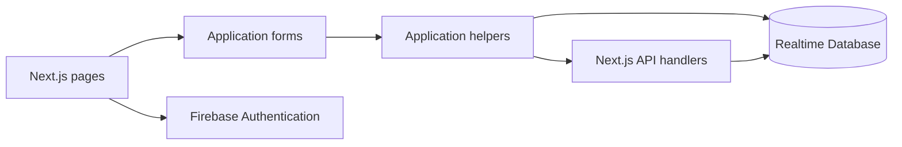

# Job Application Tracker

**Keep job applications and follow-up details in one workspace.**

A Next.js and TypeScript project with Firebase authentication, application-entry forms, and a dashboard. It explores the account, form, API, and database layers needed for a personal job-search tracker.

## What is included

- Email/password registration and login.
- A dashboard for application records.
- Add and edit screens with a shared application form.
- Firebase client and Admin integrations.
- Application read/update logic and API request helpers.

## Run locally

Use Node.js/npm and a Firebase project with Authentication and Realtime Database enabled.

```bash
npm install
npm run dev
```

Configure `.env.local` using the names read by the client and Admin modules:

| Module | Settings |
|---|---|
| `lib/firebase.ts` | `NEXT_PUBLIC_FIREBASE_API_KEY`, `NEXT_PUBLIC_FIREBASE_AUTH_DOMAIN`, `NEXT_PUBLIC_FIREBASE_PROJECT_ID`, `NEXT_PUBLIC_FIREBASE_DATABASE_URL`, `NEXT_PUBLIC_FIREBASE_STORAGE_BUCKET`, `NEXT_PUBLIC_FIREBASE_MESSAGING_SENDER_ID`, `NEXT_PUBLIC_FIREBASE_APP_ID`, `NEXT_PUBLIC_FIREBASE_MEASUREMENT_ID` |
| `lib/firebase-admin.ts` | `FIREBASE_PROJECT_ID`, `FIREBASE_CLIENT_EMAIL`, `FIREBASE_PRIVATE_KEY`, `FIREBASE_DATABASE_URL` |

Open the URL printed by Next.js. Firebase Admin values are server credentials; do not give them the `NEXT_PUBLIC_` prefix.

## Architecture



## Implementation guide

- [`app/`](app): dashboard, account, add, and edit pages.
- [`app/actions.ts`](app/actions.ts): application helpers and authenticated requests.
- [`app/api/job-applications/`](app/api/job-applications): active application HTTP endpoints.
- [`pages/api/`](pages/api): legacy application endpoints.
- [`lib/`](lib): Firebase configuration and supporting code.

## Current integration boundary

The active flow uses `/api/job-applications` for creation and `/api/job-applications/:id` for deletion. Reading, table subscriptions, and the edit helper access `job-applications/<uid>/...` directly through the Firebase client SDK, so the Realtime Database rules must permit the authenticated user's operations. The separate `pages/api/applications` handlers use an older `applications/...` convention; they are not the endpoints called by the current helpers.

For a production bundle, use `npm run build` followed by `npm start` after completing service configuration.
